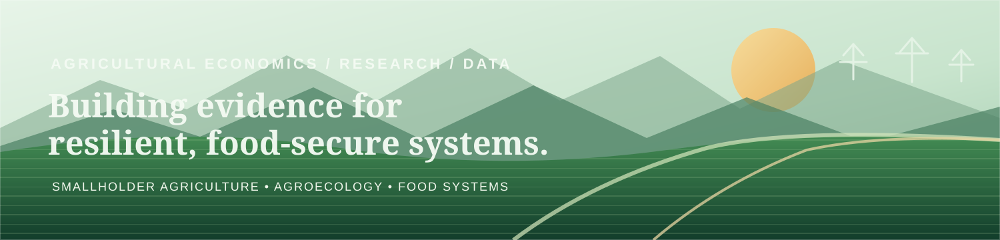
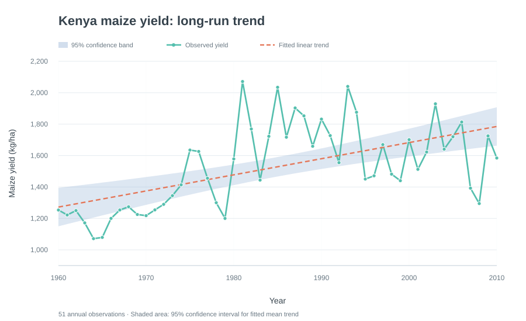
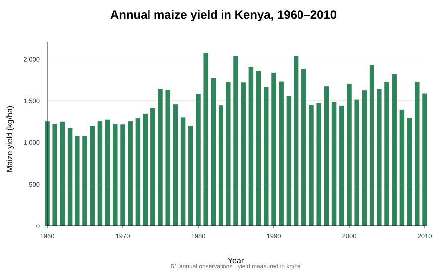
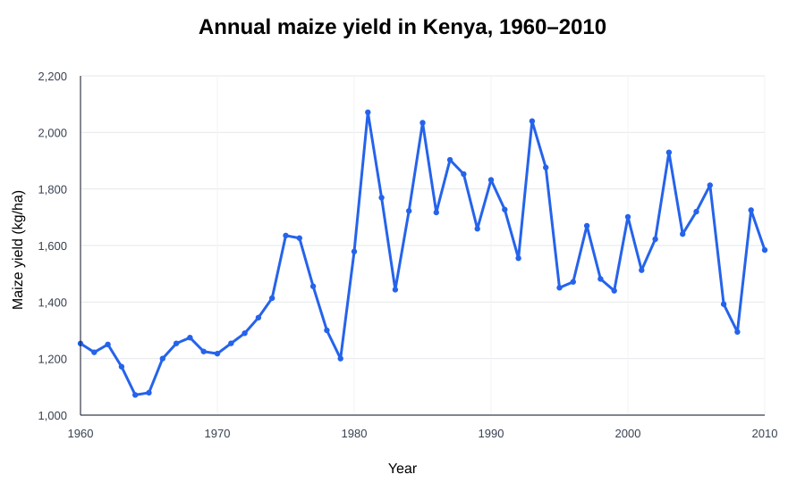

<!--
Profile README for Masika-star.
All experience, education, training and project claims below are based on the portfolio and CV information available as of November 2026.
-->

  

<h1 align="center">Masika M. Joshua</h1>

<h3 align="center">Agricultural Research · Agricultural Economics · Data Analytics</h3>

  <strong>📍 Nairobi, Kenya</strong> &nbsp;·&nbsp;
  <a href="mailto:joshuamasika@hotmail.com">joshuamasika@hotmail.com</a> &nbsp;·&nbsp;
  <a href="tel:+254797810541">+254 797 810 541</a>

  
  
  

  <strong>Interested in how evidence can strengthen smallholder agriculture, food security and rural livelihoods.</strong>

---

## About me

I am an agricultural economics professional and postgraduate researcher based in **Nairobi, Kenya**, with more than four years of experience across agricultural research and monitoring, household surveys, farmer engagement, field coordination and agricultural operations.

I hold a **BSc in Agricultural Economics and Resource Management from Maasai Mara University** and am currently pursuing an **MSc in Agricultural Economics at Chuka University**.

My work brings together agricultural research, field experience and data analysis. I am interested in understanding how farming practices, production decisions and institutional support influence smallholder livelihoods and household food security. I use tools such as Stata, Excel and KoboToolbox in research and fieldwork, and I am building my R programming and reproducible research skills through practical, documented projects.

**Current research focus:** Effects of Agroecological Practice Bundles on Household Food Security among Smallholder Maize Farmers in Kimilili Sub-County, Bungoma County, Kenya.

## Research interests

  
  
  
  
  
  

- Agricultural and food systems research
- Agroecological practices and sustainable farming systems
- Smallholder production, livelihoods and agricultural markets
- Household food security and production diversity
- Agricultural extension and technology adoption
- Applied statistics, econometrics and impact evaluation

## Technical toolkit

My current toolkit combines statistical software, field data-collection platforms and research workflow tools. R and Git/GitHub are areas of active development.

| Area | Tools and capabilities |
|---|---|
| Statistical analysis | Stata 15; R (foundational programming and tidyverse data workflows) |
| Data management | Microsoft Excel; data cleaning, validation and organisation |
| Data collection | KoboToolbox / KoboCollect; ODK; structured household surveys |
| Research methods | Quantitative and qualitative data; household surveys; key-informant interviews; focus group discussions |
| Research workflow | RStudio Projects; organised data, code and output folders; Git and GitHub |
| Literature and reporting | Zotero; Google Scholar; ResearchGate; Microsoft Word and PowerPoint |
| Other statistical tools | IBM SPSS |

  
  
  
  
  
  
  
  

## Featured projects

These projects show different stages of my work: a completed empirical analysis, an ongoing R exploration, and postgraduate research in development. I distinguish completed findings from proposed research so that the status of each project is clear.

<table>
  <tr>
    <td width="50%" valign="top">
      <h3>01 · Kenya maize-yield analysis</h3>
      

      
<strong>Additional views of the same 51 annual observations:</strong>

      

      

      
<strong>Completed empirical analysis</strong>

      
Explores Kenya's annual maize-yield series from 1960 to 2010 using a reproducible R workflow.

      <ul>
        <li>51 annual observations from a public FAOSTAT-derived series.</li>
        <li>Data validation, descriptive statistics and trend visualisation.</li>
        <li>Linear time-trend model with heteroskedasticity-robust inference.</li>
      </ul>
      
<strong>Modelled trend:</strong> approximately 10.26 kg/ha per year. This is a historical association with time, not a causal estimate.

      
<a href="https://github.com/Masika-star/Masika-star/tree/main/projects/agricultural-data-analysis">Project details and code →</a>

    </td>
    <td width="50%" valign="top">
      <h3>02 · Agroecological practice adoption</h3>
      

      
<strong>Ongoing data exploration</strong>

      
An R learning and research project exploring a multi-country African agroecology dataset and how agroecological practices are represented across farm types.

      <ul>
        <li>Started with 98 observations and 46 variables.</li>
        <li>Removed 18 entirely empty columns from a working copy, leaving 98 observations and 28 variables.</li>
        <li>Checked duplicate records and investigated missing livestock-related values.</li>
      </ul>
      
<strong>Current work:</strong> checking variable definitions and data quality before exploring practice-adoption patterns.

      
<a href="https://github.com/Masika-star/agroecological-practice-adoption">Project repository →</a>

    </td>
  </tr>
  <tr>
    <td width="50%" valign="top">
      <h3>03 · MSc research: practice bundles and food security</h3>
      

      
<strong>Postgraduate research project · Kimilili, Kenya</strong>

      
Examines the effects of agroecological practice bundles on household food security among smallholder maize farmers in Kimilili Sub-County, Bungoma County.

      <ul>
        <li>Characterises combinations of agroecological practices.</li>
        <li>Examines their relationship with household food security.</li>
        <li>Investigates production diversity as a pathway linking practice bundles and food security.</li>
      </ul>
      
<em>Research framework and analytical plan under development; no empirical results are claimed here.</em>

      
<a href="https://github.com/Masika-star/Masika-star/tree/main/projects/agroecology-food-security">Research framework →</a>

    </td>
    <td width="50%" valign="top">
      <h3>04 · Additional research frameworks</h3>
      
<strong>Concept development</strong>

      
I am also outlining research workflows on related agricultural and development questions:

      <ul>
        <li><a href="https://github.com/Masika-star/Masika-star/tree/main/projects/climate-smart-poultry">Climate-smart agriculture, poultry productivity and household income</a>.</li>
        <li><a href="https://github.com/Masika-star/Masika-star/tree/main/projects/impact-evaluation">Impact evaluation of agricultural and development interventions</a>.</li>
      </ul>
      
<em>These are developing research concepts, not completed empirical studies.</em>

    </td>
  </tr>
</table>

## Professional Experience

My experience combines agricultural research, monitoring and evaluation, household-level data collection, field coordination and farm operations. The roles below are presented in reverse chronological order.

### 🔎 Research and M&E Analyst
**Policy and Market Option** · *February 2023 – October 2024*

- Conducted desk research to support the development of research and monitoring and evaluation approaches, methodologies and reports.
- Analysed quantitative and qualitative information from interviews, surveys and focus group discussions.
- Supported the planning and coordination of agricultural research activities, including sampling, study scope and analytical frameworks.
- Collected, organised, cleaned and checked data, following up on discrepancies to improve data quality.
- Prepared presentations and shared findings with stakeholders to support discussions on programme activities and resource allocation; submitted regular field updates and maintained respectful working relationships with community members and local stakeholders.

### 🚜 Farm Manager
**Mabanga ATC Farms** · *March 2022 – January 2023*

- Coordinated crop and livestock farm operations, including equipment maintenance, labour planning, and the recruitment and supervision of seasonal workers during cultivation and harvest.
- Maintained farm activity records and supported purchasing, marketing and customer relations.
- Monitored crop health and product quality and supported sustainable waste-recycling practices.

### 🌱 Agricultural Intern
**Ministry of Agriculture, Kimilili Sub-County** · *March 2021 – August 2021*

- Supported agricultural extension and field-monitoring activities with smallholder farmers and accompanied agricultural officers during field visits.
- Organised agricultural information in Microsoft Excel and prepared data summaries and reports to support departmental planning and farmer-facing activities.

### 🏠 Census Enumerator
**Kenya National Bureau of Statistics (KNBS)** · *August 2019*

- Conducted household visits and interviews to collect demographic and household information, following standard enumeration procedures and data-quality requirements.

## Education and professional development

**Academic qualifications**

- **MSc Agricultural Economics** — Chuka University, Kenya | 2025–Present
- **BSc Agricultural Economics and Resource Management** — Maasai Mara University, Kenya | 2016–2020

**Selected training**

- Managing Successful Field Research — World Bank Group, Institute for Economic Development | 2025
- Google Data Analytics Professional Certificate — Grow with Google / Coursera | 2023–2024
- Google IT Support Professional Certificate — Grow with Google / Coursera | 2023–2024
- Data Analysis in Excel — Digital Opportunity Trust | 2022–2023
- Computer Applications Certificate — Sang’alo Institute of Science & Technology | 2020–2021

## How I approach research

I begin by defining the research question and understanding the data before selecting an analytical method. My workflow is built around:

1. **Organised projects:** separate folders for data, code and outputs.
2. **Data quality:** inspect structure, missing values, duplicates, variable definitions and unusual observations before analysis.
3. **Appropriate methods:** match the research question and data structure to the method, then examine assumptions and diagnostics.
4. **Reproducibility:** document code, data-processing decisions and analytical steps.
5. **Careful interpretation:** distinguish description, association and causal evidence, and report limitations clearly.

Restricted or confidential farmer-level data are not published in this portfolio.

## GitHub activity

  
  

## Connect With Me

I welcome opportunities for research collaboration, agricultural data analysis, field research, monitoring and evaluation, and evidence-based work on food systems and rural development.

  📍 Nairobi, Kenya &nbsp;·&nbsp; 📞 <a href="tel:+254797810541">+254 797 810 541</a>

  
  
  

  <em>Research carefully. Analyse clearly. Contribute to better agricultural and food systems.</em>

